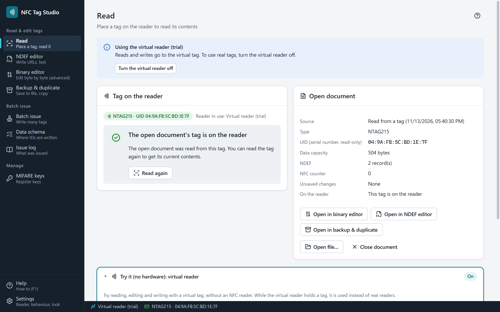

# NFC Tag Studio

[](https://github.com/UnlitCube/nfc-tag-studio/actions/workflows/ci.yml)
[](https://github.com/UnlitCube/nfc-tag-studio/releases)
[](LICENSE)

[日本語](README.md) · [Website](https://unlitcube.github.io/nfc-tag-studio/en/) · [Download](https://github.com/UnlitCube/nfc-tag-studio/releases)

A Windows desktop app to **read, edit, write, back up and batch-issue** the NFC tags your organization manages &mdash; NTAG213/215/216, MIFARE Classic 1K/4K and FeliCa Lite-S. Use it to number employee or member cards, or to write URLs and Wi-Fi settings. Free and MIT licensed. The app has an English UI; the user guide (Wiki) is in Japanese.



> **Intended use**: tags you are authorized to manage. The app never writes or copies the UID (serial number), never cracks MIFARE Classic keys (only keys you register are used), and cannot be used to clone other people's cards or bypass authentication.

## Features

| Screen | What it does |
|---|---|
| Read | Reads a tag as soon as it is placed and shows UID, type, capacity, NDEF and lock state. Unreadable areas are reported with the reason (key/password needed, or communication lost) |
| NDEF editor | URL, text, Wi-Fi, contact (vCard), Android app (AAR), MIME, external and smart poster records, with a capacity meter |
| Binary editor | Byte-by-byte editing per page/block with colour-coded areas, bit explanations, structure boundaries, counters and a guided settings editor |
| Backup & duplicate | Save to `.nfcdump`, `.bin` or Flipper `.nfc` and write back to the same or another tag (data area only; the UID is never copied) |
| Batch issue | Write sequence numbers, CSV rows, NDEF or a backup to one tag after another, with skipping of issued tags, verification, resume and an issue log (CSV) |
| Data schema | Lay out where and how an ID is written and save it as `.nfcschema` |
| MIFARE keys | Register the keys you operate (masked on screen, encrypted with Windows DPAPI). Public default keys are included |
| Virtual reader | Try everything from reading to batch issue without a reader |

Japanese and English UI, light and dark themes, sounds, a first-run guide and in-app help (F1).

## Requirements

- Windows 10 / 11 (64-bit)
- An NFC reader that works with PC/SC &mdash; or the built-in virtual reader

| Reader | NTAG213/215/216 | FeliCa Lite-S | MIFARE Classic | Checked with |
|---|---|---|---|---|
| Sony PaSoRi (RC-S380) | Read & write (no password auth, counters or signature) | Read & write | Not checked yet | Real hardware |
| ACR122U and similar | Read & write, password auth, counters, signature | Read & write | Read & write with your keys | Virtual reader only |

## Install

1. Download `NFC-Tag-Studio-<version>-win-x64-portable.exe` (runs as is) or `NFC-Tag-Studio-<version>-win-x64.zip` (extract and run) from [Releases](https://github.com/UnlitCube/nfc-tag-studio/releases). No installation is needed.
2. The executables are not code-signed, so Windows SmartScreen asks first: choose "More info" &rarr; "Run anyway".
3. Connect the reader and place a tag (for a Sony PaSoRi, install "NFC Port Software" first).

Settings, registered keys and the issue log are stored in `%APPDATA%\NFC Tag Studio`. To uninstall, delete the exe (or the extracted folder) and, if you no longer need them, that folder.

## Known limitations

- Windows (x64) only; there are no macOS or Linux builds.
- Storage-type readers such as the Sony PaSoRi cannot do NTAG password authentication, NFC counters or signature reads.
- ACR122U-type readers and MIFARE Classic have been checked with the virtual reader only.
- FeliCa support is limited to FeliCa Lite-S (no transit cards, no MAC authentication).
- 0.x releases are betas. See [CHANGELOG.md](CHANGELOG.md) (Japanese).

## Development

Node.js 22.12 or later (releases are built with the version in [`.node-version`](.node-version)).

```bash
npm ci             # install (also fetches the Electron binary)
npm run dev        # start in development mode
npm test           # type check + unit tests + logic smoke
npm run e2e        # UI flows with the virtual reader only
npm run dist:win   # portable exe and zip in release/
```

Electron + electron-vite + React 19 + TypeScript + zustand; PC/SC through koffi calling `winscard.dll` directly. See [CONTRIBUTING.md](CONTRIBUTING.md), [SECURITY.md](SECURITY.md) and [docs/RELEASING.md](docs/RELEASING.md) (Japanese).

## License

MIT License ([LICENSE](LICENSE)). Third-party licenses: [THIRD_PARTY_NOTICES.txt](THIRD_PARTY_NOTICES.txt). Trademarks: [docs/LEGAL.md](docs/LEGAL.md).

NFC Tag Studio is not a product of, and is not affiliated with or endorsed by, NXP Semiconductors, Sony, Advanced Card Systems or the NFC Forum. MIFARE and NTAG are trademarks of NXP B.V.; FeliCa and PaSoRi are trademarks of Sony Group Corporation.

## Disclaimer

Provided as is. Some writes cannot be undone (lock bits, passwords, write protection). Back up important tags first.
