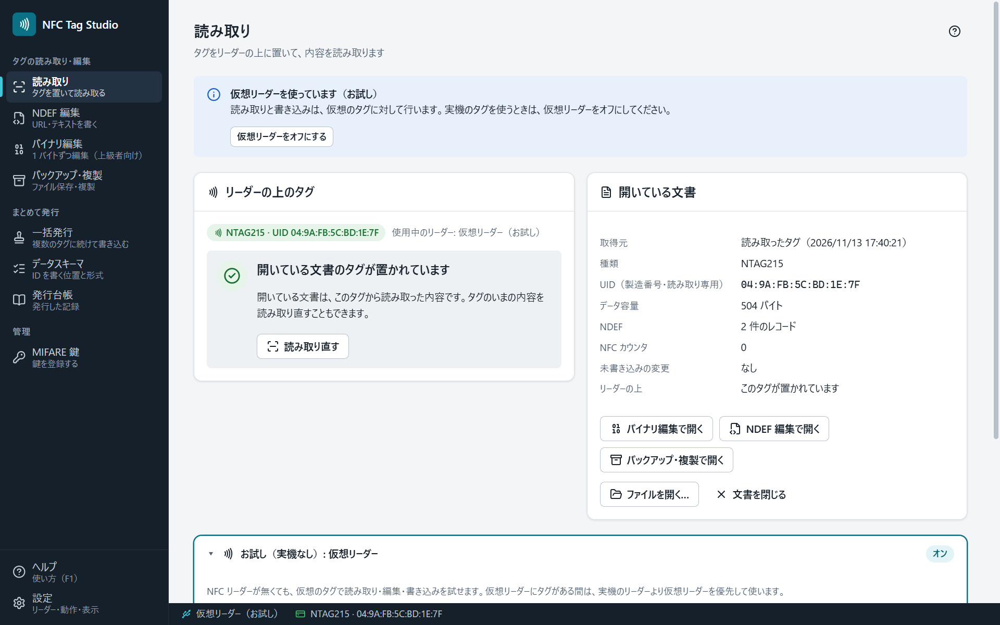
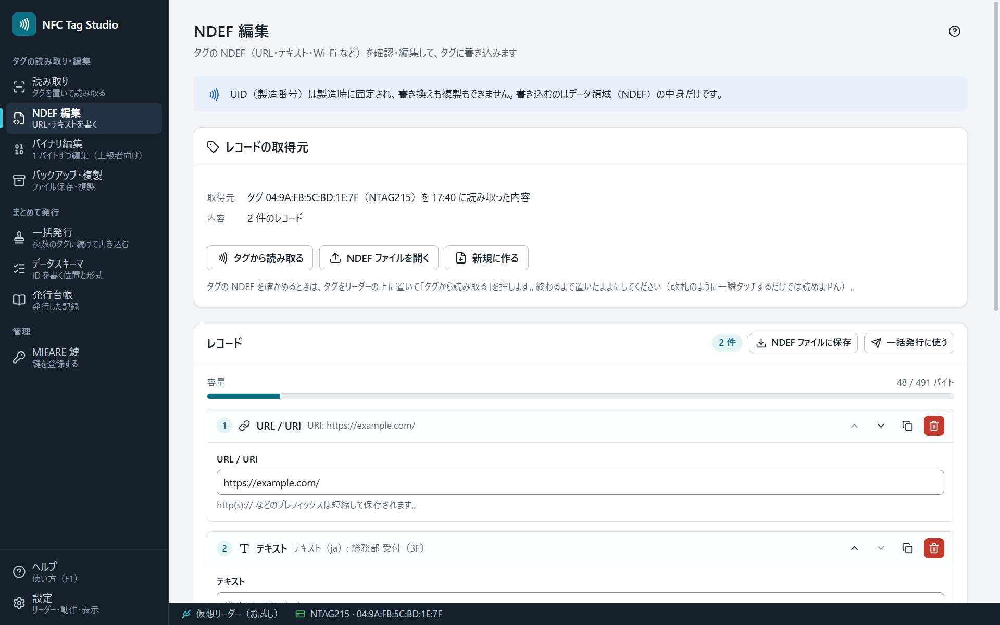
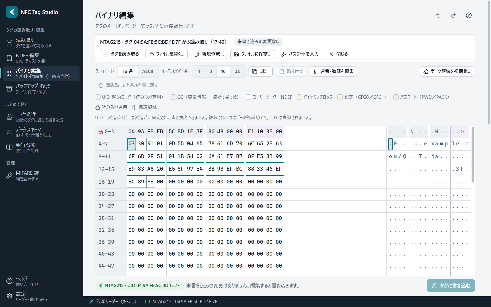
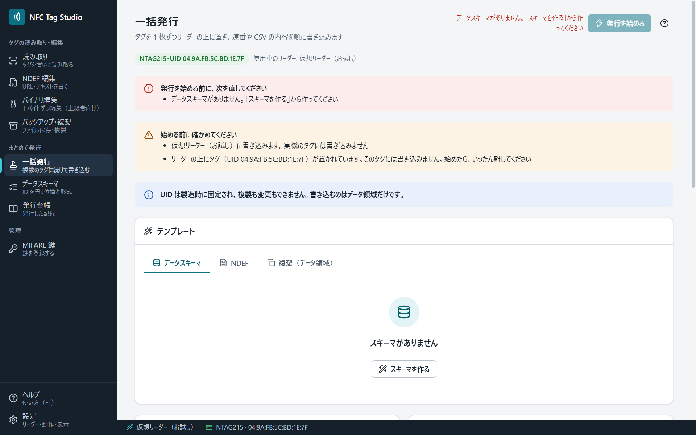
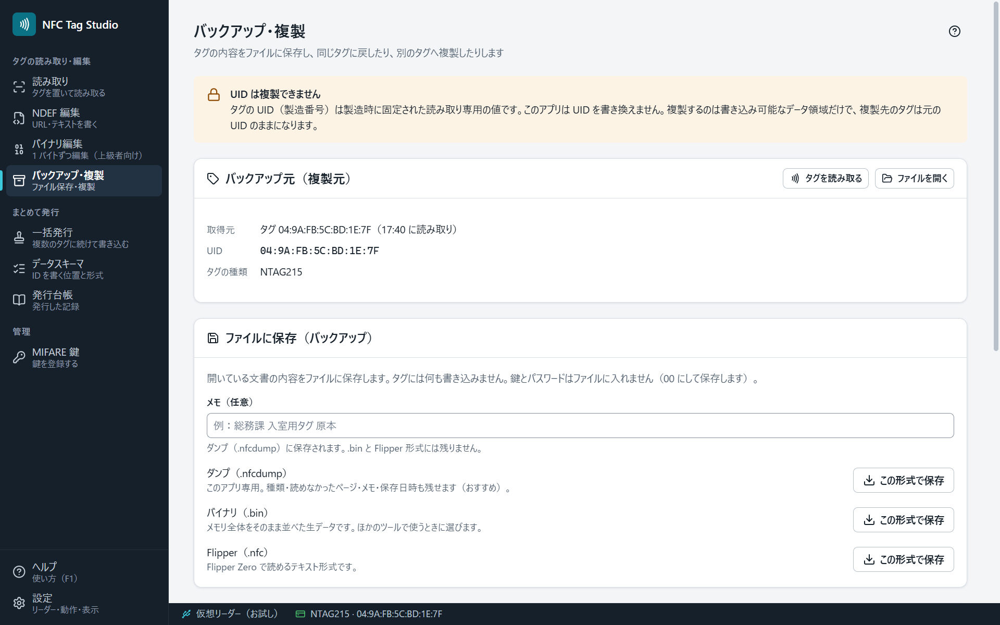

# NFC Tag Studio

[](https://github.com/UnlitCube/nfc-tag-studio/actions/workflows/ci.yml)
[](https://github.com/UnlitCube/nfc-tag-studio/releases)
[](LICENSE)

[English](README.en.md) ・ [紹介ページ](https://unlitcube.github.io/nfc-tag-studio/) ・ [使い方（Wiki）](https://github.com/UnlitCube/nfc-tag-studio/wiki) ・ [ダウンロード](https://github.com/UnlitCube/nfc-tag-studio/releases)

自組織で管理する NFC タグ（NTAG213/215/216・MIFARE Classic 1K/4K・FeliCa Lite-S）を、**読み取り・編集・書き込み・バックアップ・一括発行**する Windows のデスクトップアプリです。社員証や会員証への ID の採番、URL や Wi-Fi の設定の書き込みに使えます。無料・MIT ライセンス。



> **対象と前提**: 管理・運用する権限を持っているタグに使うためのアプリです。UID（製造番号）は書き換えず、複製もしません。MIFARE Classic の鍵の解析はせず、運用者が登録した鍵だけで開きます。他人のカードの不正な複製や認証の回避には使えない作りです（[安全の約束](https://github.com/UnlitCube/nfc-tag-studio/wiki/安全の約束)）。

## できること

| 画面 | できること |
|---|---|
| 読み取り | タグを置くと自動で読み取り、UID・種類・容量・NDEF・ロックの状態を表示。読めなかった領域は理由（鍵・パスワードが必要／通信が途切れた）ごとに示す |
| NDEF 編集 | URL・テキスト・Wi-Fi・連絡先（vCard）・アプリの起動（AAR）・MIME・External・スマートポスター。容量のメーターつき |
| バイナリ編集 | ページ／ブロックごとに 1 バイトずつ編集。領域の色分け・ビットの意味の解説・構造の境目・連番の増減・設定の解説つき編集 |
| バックアップ・複製 | `.nfcdump`・`.bin`・Flipper の `.nfc` に保存し、同じタグや別のタグに書き戻す（データ領域だけ。UID は複製されない） |
| 一括発行 | 連番・CSV・NDEF・複製を、タグを置き替えながら 1 枚ずつ書き込む。発行済みのスキップ・照合・止めた所から再開・発行台帳（CSV） |
| データスキーマ | 社員 ID などを、どの位置にどの形式で書くかを画面で組み立て、`.nfcschema` に保存 |
| MIFARE 鍵 | 運用している鍵を登録（伏字で表示し、Windows の DPAPI で暗号化して保存）。公開されている標準の鍵は同梱 |
| 仮想リーダー | リーダーが無くても、読み取りから一括発行まで一通り試せる |

日本語と英語・ライトとダークのテーマ・効果音・初回のガイド・各画面のヘルプ（F1）があります。

<table>
  <tr>
    <td></td>
    <td></td>
  </tr>
  <tr>
    <td></td>
    <td></td>
  </tr>
</table>

## 必要なもの

- Windows 10 / 11（64 ビット）
- PC/SC で使える NFC リーダー。無くても、アプリに内蔵の仮想リーダーで試せます。

| リーダー | NTAG213/215/216 | FeliCa Lite-S | MIFARE Classic | 確かめ方 |
|---|---|---|---|---|
| Sony PaSoRi（RC-S380） | 読み書き（パスワード認証・カウンタ・署名は不可） | 読み書き | まだ確かめていません | 実物で確認 |
| ACR122U など | 読み書き・パスワード認証・カウンタ・署名 | 読み書き | 運用者の鍵で読み書き | 仮想リーダーで確認（実物は未確認） |

詳しくは Wiki の [対応リーダーとタグ](https://github.com/UnlitCube/nfc-tag-studio/wiki/対応リーダーとタグ) を見てください。

## インストール

1. [Releases](https://github.com/UnlitCube/nfc-tag-studio/releases) から、`NFC-Tag-Studio-<版>-win-x64-portable.exe`（そのまま起動）か `NFC-Tag-Studio-<版>-win-x64.zip`（展開して起動）をダウンロードします。インストールは不要です。
2. 起動します。コード署名をしていないため、初めは Windows の SmartScreen の確認が出ます。［詳細情報］→［実行］で起動できます。
3. リーダーを USB に接続し、タグを置きます（Sony PaSoRi は「NFC ポートソフトウェア」を入れておきます）。

設定・登録した鍵・発行台帳は `%APPDATA%\NFC Tag Studio` に保存します。手順の詳細とアンインストールは Wiki の [インストール](https://github.com/UnlitCube/nfc-tag-studio/wiki/インストール) にあります。

## 既知の制限

- Windows（x64）専用です。macOS・Linux 向けの配布物はありません。
- Sony PaSoRi などストレージ方式のリーダーでは、NTAG のパスワード認証・NFC カウンタ・署名の読み取りは使えません。
- ACR122U などのリーダーと MIFARE Classic は、仮想リーダーでだけ確かめています。
- FeliCa は Lite-S だけに対応しています（交通系 IC などは対象外。暗号の認証（MAC）は使えません）。
- 0.x の間はベータ版です。変更の記録は [CHANGELOG.md](CHANGELOG.md) にあります。

## 開発

Node.js 22.12 以上（配布物は [`.node-version`](.node-version) の版で作ります）。

```bash
npm ci             # 依存の導入（Electron 本体の取得も自動）
npm run dev        # 開発起動（start-dev.bat をダブルクリックでも可）
npm test           # 型検査 + 単体テスト + ロジックのスモーク
npm run e2e        # 画面の流れ（仮想リーダーだけ。実機には触れない）
npm run dist:win   # release/ に portable の exe と zip を作る
```

- 構成: Electron + electron-vite + React 19 + TypeScript + zustand。PC/SC は koffi で `winscard.dll` を直接呼びます。
- `src/shared/` は main・renderer・テストが共有する純粋なロジック（タグのメモリマップ・NDEF・データスキーマ）、`src/main/` は PC/SC・仮想リーダー・発行エンジン、`src/renderer/` は画面です。
- 設計の正典は [docs/DESIGN.md](docs/DESIGN.md)、作業の罠の台帳は [CLAUDE.md](CLAUDE.md)、リリースの手順は [docs/RELEASING.md](docs/RELEASING.md) です。
- 参加のしかたは [CONTRIBUTING.md](CONTRIBUTING.md)、脆弱性の報告は [SECURITY.md](SECURITY.md) を見てください。

## ライセンス

MIT License（[LICENSE](LICENSE)）。同梱する第三者のソフトのライセンスは [THIRD_PARTY_NOTICES.txt](THIRD_PARTY_NOTICES.txt)、商標などは [docs/LEGAL.md](docs/LEGAL.md) にあります。

NFC Tag Studio は NXP Semiconductors・ソニー・Advanced Card Systems・NFC Forum の製品ではなく、各社から提携・承認を受けたものではありません。MIFARE・NTAG は NXP B.V.、FeliCa・PaSoRi はソニーグループ株式会社の商標です。

## 免責

本ソフトウェアは現状のまま提供されます。タグへの書き込みには、取り消せないものがあります（ロック・パスワード・書込保護）。大切なタグは先にバックアップを取ってから使ってください。
