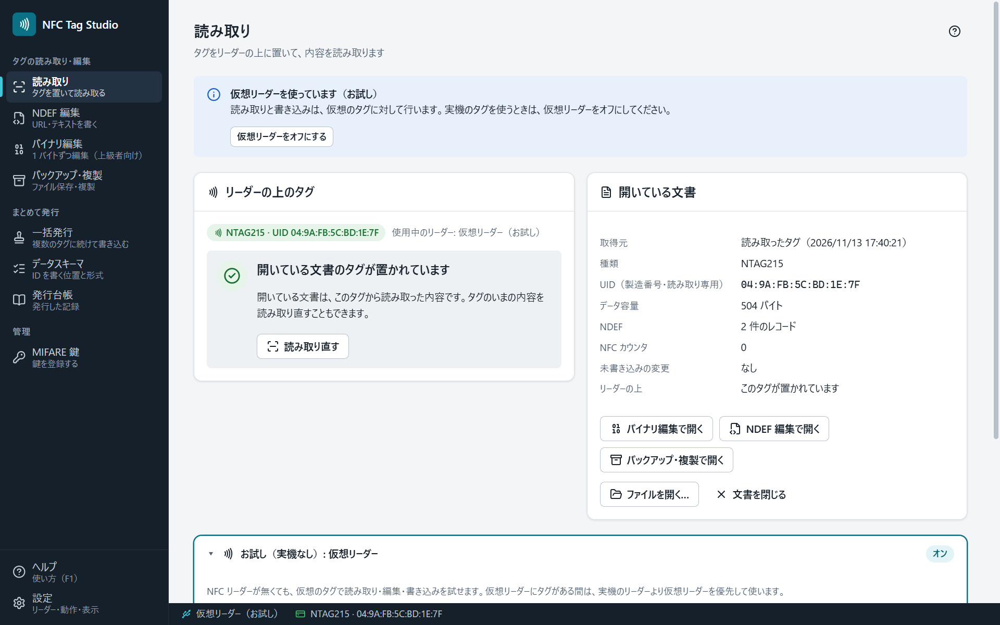

# NFC Tag Studio の使い方

NFC Tag Studio は、自組織で管理する NFC タグ（NTAG213/215/216・MIFARE Classic 1K/4K・FeliCa Lite-S）を、読み取り・編集・書き込み・バックアップ・一括発行する Windows のデスクトップアプリです。無料で、MIT ライセンスのオープンソースです。

## はじめての方へ

1. [[インストール]] — ダウンロードして起動するまで（SmartScreen の確認の進め方を含む）
2. [[はじめに]] — 1 枚のタグを読み取って、編集して、書き込むまで
3. [[対応リーダーとタグ]] — 手元のリーダーで何ができるか

リーダーが無くても、[[仮想リーダー]]で一通り試せます。

## 画面ごとの使い方

| 画面 | できること |
|---|---|
| [[読み取り]] | タグを置いて読み取り、内容を確かめる |
| [[NDEF編集]] | URL・テキスト・Wi-Fi など、スマートフォンで読める内容を書く |
| [[バイナリ編集]] | メモリを 1 バイトずつ編集する（上級者向け） |
| [[バックアップと複製]] | ファイルに保存し、同じタグや別のタグに書き戻す |
| [[一括発行]] | 連番・CSV・NDEF を、タグを置き替えながら続けて書き込む。発行台帳 |
| [[データスキーマ]] | 社員 ID などを、どの位置にどの形式で書くかを決める |
| [[MIFARE鍵]] | MIFARE Classic を開く鍵を登録する |
| [[設定]] | 使うリーダー・自動読み取り・上級者モード・表示 |

## 困ったとき

- [[トラブルシューティング]] — タグを置いても反応しない・リーダーが出ない・書き込みに失敗した
- [[安全の約束]] — このアプリがすること・しないこと（UID・鍵・取り消せない操作）
- 不具合の報告や要望は [Issues](https://github.com/UnlitCube/nfc-tag-studio/issues) へ。脆弱性は [セキュリティポリシー](https://github.com/UnlitCube/nfc-tag-studio/security/policy) の手順で、非公開で知らせてください。

## 開発に参加する

- [[開発者向け]] — ソースからのビルド・テスト・リリースの流れ

> この Wiki の元は、リポジトリの [`wiki/`](https://github.com/UnlitCube/nfc-tag-studio/tree/master/wiki) です。直すときは、そのファイルへの Pull Request で送ってください（Wiki の画面で直接編集した分は、次の同期で上書きされます）。
