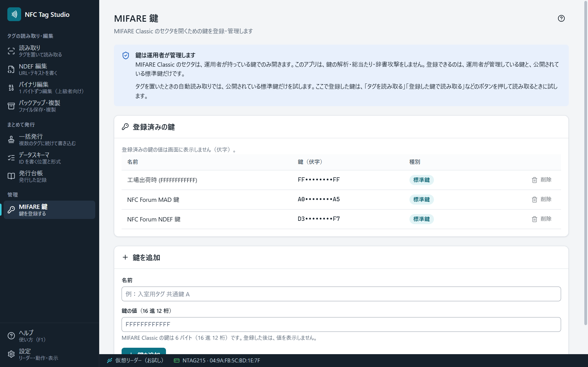

# MIFARE 鍵

MIFARE Classic は、セクタごとに鍵（Key A / Key B）で保護されたタグです。読み書きには、そのタグに設定された鍵が要ります。「MIFARE 鍵」の画面で、運用している鍵を登録します。

## 登録した鍵の扱い

- 画面では伏字で表示し、値は出しません。
- `%APPDATA%\NFC Tag Studio\keys.json` に、Windows の資格情報の保護（DPAPI）で暗号化して保存します。別の PC や別の Windows のユーザーでは開けません。
- ログ・発行台帳・バックアップのファイルには入れません。

## 公開されている標準の鍵

工場出荷時の鍵と、NFC Forum の MAD・NDEF の鍵は、最初から入っています。

## どの鍵を試すか

| 読み取り方 | 試す鍵 |
|---|---|
| タグを置いたときの自動読み取り | 公開されている標準の鍵だけ |
| ［タグを読み取る］［登録した鍵で読み取る］を押したとき | 標準の鍵と、登録した鍵 |

置いただけのタグに登録した鍵を試させないためです。偽装したカードに認証を何度も試させると、鍵を割り出されるおそれがあります。

## このアプリがしないこと

鍵の解析・総当たりはしません。鍵が分からないセクタは読み書きできません（[[安全の約束]]）。
