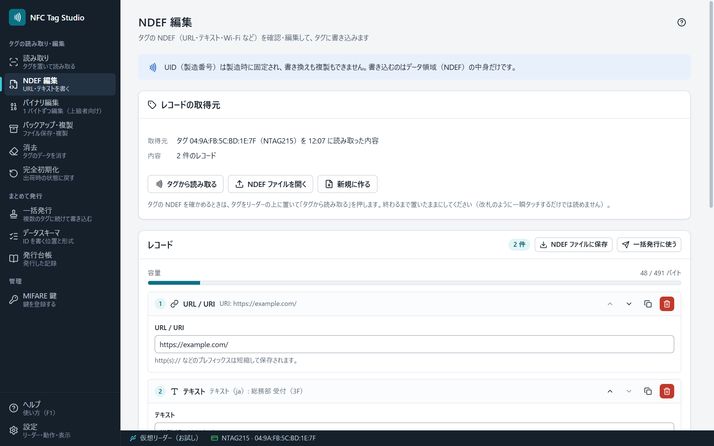

# NDEF 編集

NDEF は、スマートフォンや NFC リーダーが読める標準のデータ形式です。「NDEF 編集」では、レコードを組み立てて、タグに書き込みます。

## 使えるレコード

| レコード | 例 |
|---|---|
| URL / URI | `https://example.com/` |
| テキスト | 案内の文・管理番号 |
| Wi-Fi | ネットワーク名と認証の方式（スマートフォンで読むと接続の案内が出ます） |
| 連絡先（vCard） | 名前・電話・メール |
| アプリの起動（AAR） | Android のアプリのパッケージ名 |
| MIME | 任意の種類のデータ |
| External | 独自の種類のデータ |
| スマートポスター | URL とタイトルの組み合わせ |

## 書き込むまで

読み取る前は、レコードの編集欄は出ません。［タグから読み取る］［NDEF ファイルを開く］［新規に作る］のどれかで始めます。ほかの画面で読み取ったタグは引き継ぎません（「読み取り」画面で読んだタグを使うときは、そこで［NDEF 編集で開く］を押します）。

1. この画面でタグを置きます（自動で読み取ります）。置いたまま別の画面から移ってきたときは、［タグから読み取る］を押します。タグに書かれているレコードが一覧に出ます。
2. ［レコードを追加］で足し、上下の矢印で並べ替えます。
3. 「容量」のメーターで、タグに収まるか確かめます。
4. ［タグに書き込む］を押します。

書き込み先は、**いまリーダーの上に置いてあるタグ**です。書き込む直前にそのタグを読み取り、その中身をもとに書き込む内容を決めます。読み取ったタグと別のタグなら、確認にそう出ます。書き込んでも、ほかの画面（バイナリ編集など）で開いている内容は変わりません。書き込みの結果は、この画面にだけ出ます。

## 編集をやめる

画面の下の［キャンセル］を押すと、組み立て中のレコードを捨てて、読み取る前の画面に戻ります（捨てる前に確認が出ます。［編集を続ける］で戻れます）。未書き込みのレコードが無いときは［閉じる］です。この画面で読み取ったタグの内容も閉じます（ほかの画面の内容はそのままです）。

## NDEF を消去する

タグの NDEF を空にするときは、［NDEF を消去］を使います（レコードを 0 件にして書き込むことはできません）。消去の前に確認が出ます。

## ファイルと一括発行

- ［NDEF ファイルに保存］［NDEF ファイルを開く］で、レコードの組をファイルに残せます。
- ［一括発行で使う］で、同じ内容を何枚にも書けます。一括発行では、`{{seq}}`（連番）や `{{uid}}` などの差し込みで、タグごとに内容を変えられます（[[一括発行]]）。

## 対応していないタグ

FeliCa Lite-S は NDEF 編集に対応していません。[[バイナリ編集]]を使います。
