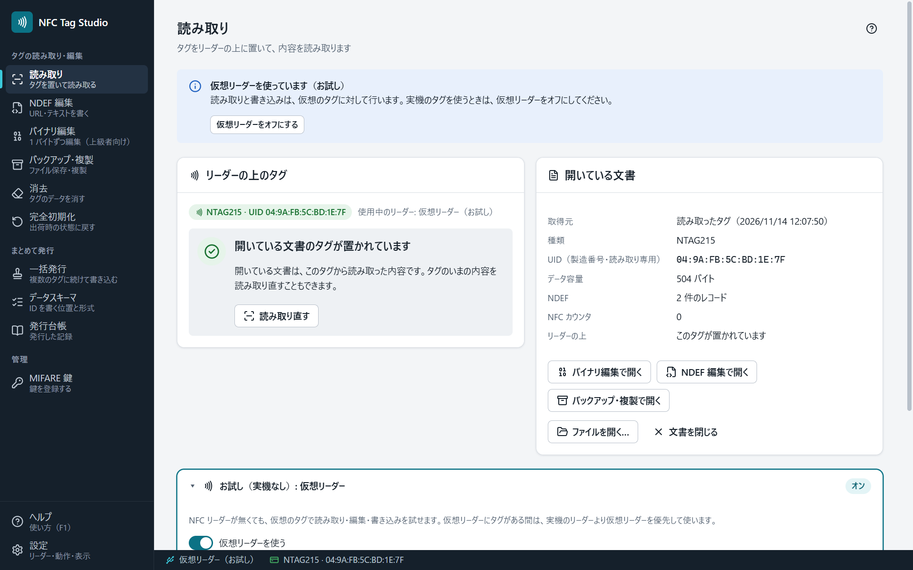

# はじめに：1 枚のタグを編集する

読み取り → 編集 → 書き込み、の流れを 1 回通します。リーダーが無いときは、先に [[仮想リーダー]] をオンにしてください。

## 1. リーダーをつなぐ

NFC リーダーを USB に接続してから、アプリを起動します。画面の下の状態表示に、使っているリーダーの名前が出ます。リーダーが出ないときは [[トラブルシューティング]] を見てください。

## 2. タグを置く

タグをリーダーの中央に置きます。**読み取り・書き込みが終わるまで、置いたままにしてください。** 改札のように一瞬タッチするだけでは読めません。

置くと自動で読み取り、「読み取り」画面に内容が出ます。

- 左の「リーダーの上のタグ」は、いまリーダーに置かれているタグの状態です。
- 右の「開いている文書」は、読み取った内容です。タグを離しても残ります。

## 3. 編集する

何を書くかで、画面を選びます。

- URL・テキスト・Wi-Fi など、スマートフォンで読める内容 → [[NDEF編集]]
- メモリを 1 バイトずつ → [[バイナリ編集]]（上級者向け）

読み取ったタグは、画面ごとに持ちます。「読み取り」画面で読んだタグは、ほかの画面には引き継ぎません。編集の画面では、その画面の［タグを読み取る］（NDEF 編集は［タグから読み取る］）で読み取るか、「読み取り」画面の［NDEF 編集で開く］［バイナリ編集で開く］を押します。画面を移っても、それぞれの画面の作業中の内容は残ります。

## 4. 書き込む

編集した画面の右下の［タグに書き込む］を押します。確認に、書き込み先のタグ（種類と UID）が出るので、置いているタグと同じか確かめて、確認の［タグに書き込む］を押します。

書き込みの後、アプリはタグを読み戻して照合します。結果（成功・失敗・どこが書けなかったか）は、画面を閉じるまで残ります。

## 5. やめるとき

編集をやめるときは、画面の下の［キャンセル］（未書き込みの変更が無いときは［閉じる］）を押します。読み取る前の画面に戻ります。

## 6. ファイルに残す（任意）

いまの内容をファイルに保存しておくと、後で同じタグや別のタグに書き戻せます（[[バックアップと複製]]）。

## 次に読む

- 同じ内容や連番を何枚にも書く → [[一括発行]]
- 社員 ID などの書き方を決める → [[データスキーマ]]
- このアプリがしないこと（UID の書き換えなど） → [[安全の約束]]
