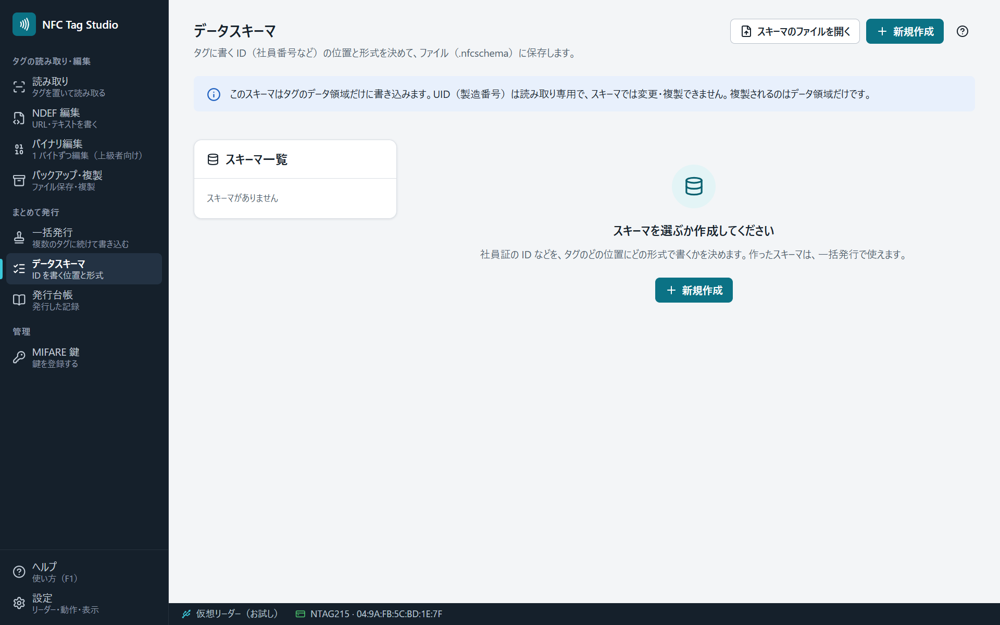

# データスキーマ

データスキーマは、社員 ID などのデータを、タグのどの位置にどの形式で書くかを決めるものです。画面で組み立てて、ファイル（`.nfcschema`）に保存し、[[一括発行]]で使います。

## フィールド

1 つのスキーマに、いくつかのフィールド（例: 社員 ID・発行日・チェックサム）を並べます。フィールドごとに、次を決めます。

| 項目 | 選べるもの |
|---|---|
| 形式 | 符号なし整数・BCD・ASCII・UTF-8・16 進・日付・チェックサム |
| 値の出どころ | 固定値・入力・連番・CSV の列・現在の日時・UID の一部 |
| 位置と長さ | タグのどこから何バイトか。フィールドどうしの重なり・タグに収まるか・UID や保護領域にかからないかを検査します |

## 連番

値の出どころを「連番」にすると、一括発行でタグを 1 枚発行するたびに値が増えます。開始値と増分は「一括発行」の画面で決めます。

## ファイルの形式

`.nfcschema` は JSON のファイルです。形式の詳しい説明は、リポジトリの [docs/SCHEMA-FORMAT.md](https://github.com/UnlitCube/nfc-tag-studio/blob/master/docs/SCHEMA-FORMAT.md) にあります。
