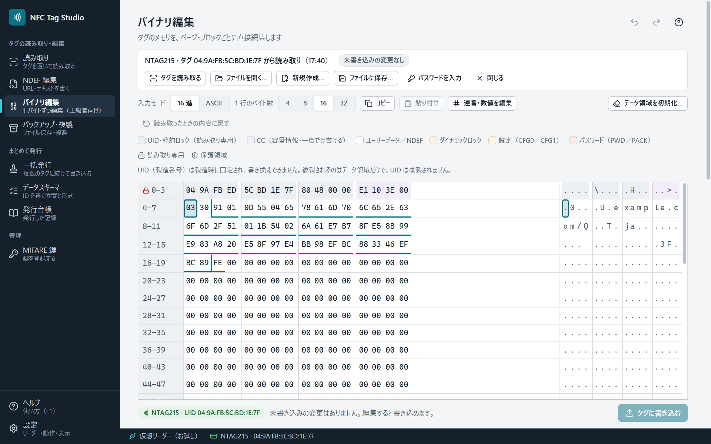

# バイナリ編集（上級者向け）

タグのメモリを、ページ（NTAG）またはブロック（MIFARE Classic・FeliCa Lite-S）ごとに表示し、1 バイトずつ編集します。

## 画面の見方

- 上の帯で、何を編集するかを選びます: ［タグを読み取る］［ファイルを開く…］［新規作成…］［ファイルに保存…］［閉じる］。
- 表は領域ごとに色分けしています（UID・ロック・CC・ユーザーデータ・設定・パスワードなど）。鍵の印は読み取り専用、盾の印は保護領域です。
- バイトを選ぶと、そのバイトとビットの意味の解説が出ます。NDEF・TLV の構造の境目も表に示します。
- 「1 行のバイト数」（4・8・16・32）で、表の幅を変えられます。
- 入力は 16 進か ASCII を選べます。検索・置換・コピー・貼り付け・元に戻す（Ctrl+Z）が使えます。

## 書き込む

下の帯の［タグに書き込む］で、リーダーの上のタグに書き込みます。

- 書き込むのは、**変更したページ・ブロックだけ**です。
- 書き込む前に、書き込み先のタグ（種類と UID）を確認に出します。
- 読み取ったタグと別のタグ、ファイル、新規の文書から書くと「複製」になります。そのときは書き込み先のタグを先に読み取り、その中身との違いだけを書きます。
- 書き込みの後に読み戻して照合します。書けなかったページ・ブロックがあれば、理由と次にすることを表示し、書けなかった編集は未書き込みの変更として残ります。

## 連番・数値を編集

［連番・数値を編集］で、選んだバイトの範囲を数値として +1 / −1 したり、任意の増分を足したり、値を入れたりできます。連番のカウンタを手で調整するときに使います。

## 設定（パラメータ）を編集

NFC カウンタ・パスワード保護（NTAG）、セクタのアクセス条件（MIFARE Classic）、MC（FeliCa Lite-S）などは、解説つきの画面で編集できます。結果は、表の上の未書き込みの変更になります。

## 保護領域と、取り消せない操作

- UID のページ（NTAG のページ 0〜1、MIFARE のブロック 0）は、どの設定でも書き込めません。
- CC・ロック・設定・パスワード・トレーラ・MC などの保護領域は、[[設定]]で上級者モードをオンにし、「保護領域も編集して書き込む」をオンにしたときだけ編集できます。書き込むときは、語の入力で確かめます。
- ロックビット・CFGLCK・FeliCa の書込保護は、一度かけると元に戻せません。FeliCa の書込保護は、タグを置き直すと有効になります。

## パスワードで保護した NTAG

［パスワードを入力］でパスワードを入れてから、読み取り・書き込みをします。パスワードはアプリに保存しません。パスワード認証は ACR122U などのリーダーでだけ使えます（Sony PaSoRi では使えません。[[対応リーダーとタグ]]）。

## データ領域を初期化

［データ領域を初期化…］で、ユーザー領域を空のタグと同じ内容にする編集を作ります（書き込むまではタグは変わりません）。
