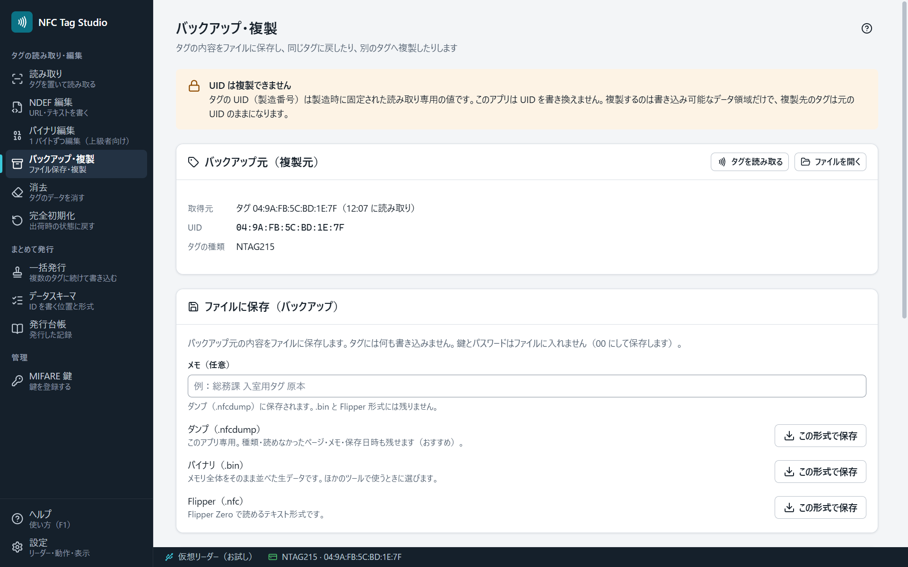

# バックアップと複製

「バックアップ・複製」では、タグの内容をファイルに保存し、同じタグや別のタグに書き戻せます。

## 保存できる形式

| 形式 | 中身 |
|---|---|
| `.nfcdump` | このアプリの形式。タグの種類・UID・読めなかった領域の情報も残ります |
| `.bin` | メモリの中身だけ（ほかの道具と受け渡すとき） |
| Flipper の `.nfc` | Flipper Zero の形式 |

保存したファイルは、「読み取り」画面の［ファイルを開く…］でも開けます。

タグを読み取るか、ファイルを開くまでは、保存や書き戻しの欄は出ません。終わったら、画面の下の［このタグに戻す］／［複製］の左にある［閉じる］で、読み取る前の画面に戻ります。

バックアップ元（保存・書き戻しの元）は、この画面の［タグを読み取る］［ファイルを開く］か、「読み取り」画面の［バックアップ・複製で開く］で決めます。ほかの画面で開いている内容は使いません。[[バイナリ編集]]で編集した内容をファイルに残すときは、バイナリ編集の［ファイルに保存…］を使います。

## 書き戻す

- 元のタグに戻す: ［このタグに戻す］を使います。
- 別のタグに書く: 複製を使います。確認に「別のタグへ書き込みます（複製）」と、書き込み先の種類と UID が出ます。
- 何枚にも続けて複製するときは、[[一括発行]]を使います。

## 複製されないもの

- **UID は複製されません。** UID は製造時に固定され、書き換えできないためです（[[安全の約束]]）。複製されるのは、書き込みできるデータ領域（ユーザーメモリ・NDEF）だけです。
- そのため、UID だけで本人を確かめる入退室のシステムでは、複製したタグは別のタグとして扱われます。複製・再発行をするなら、データ領域の内容（社員 ID など）で判定する運用が向いています。

## 鍵とパスワードはファイルに入れません

保存の前に、MIFARE の鍵 A・鍵として使う設定の鍵 B と、NTAG のパスワード（PWD・PACK）を 00 にします。画面のバックアップ元はそのままです。鍵 B を読める設定のセクタでは、鍵 B は鍵として使えないただのデータなので、そのまま残ります。
