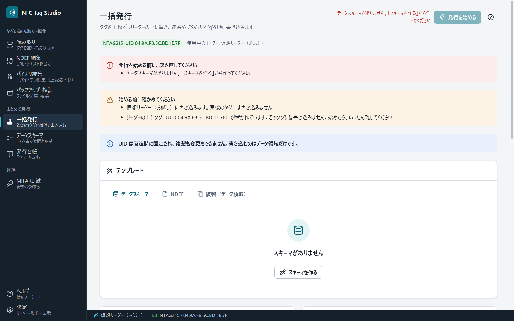

# 一括発行

タグを 1 枚ずつリーダーの上に置き替えながら、同じ内容や、連番・CSV の値を続けて書き込みます。社員証・会員証への ID の採番や、同じ URL のタグを何枚も作るときに使います。

## 書き込む内容

| 内容 | 使い方 |
|---|---|
| データスキーマ | [[データスキーマ]]で決めた位置と形式で、連番・CSV の列などを書きます |
| NDEF | [[NDEF編集]]で作ったレコード。`{{seq}}`（連番）・`{{uid}}` などの差し込みで、タグごとに内容を変えられます |
| 複製 | バックアップのファイルのデータ領域（UID は複製されません） |

連番は開始値と増分を決めます。CSV を使うときは、「開始する行」で何行目から発行するかを選べます。

## 発行の流れ

1. 内容を決め、［発行を始める］を押します。始められないときは、理由がボタンの横に出ます。
2. タグをリーダーの上に置くと、自動で書き込みます。**音が鳴って結果（成功・スキップ・失敗）が出るまで、置いたままにします。**
3. 結果が出たら、タグを離して次のタグを置きます。1 枚ごとの結果は、次のタグを置くまで表示します。

- 開始したときにリーダーの上にあったタグには書き込みません。いったん離してから置き直します。
- 途中で離したタグは、途中までしか書き込まれていません。同じタグを置き直すと、同じ番号で書き直します。別のタグに回した番号は、欠番として台帳に残ります。

## 二重の発行を防ぐ

- 「発行台帳に記録のある UID のタグはスキップする」をオンにすると、発行済みのタグを置いても書きません。
- 「空のタグにだけ書き込む」を選ぶと、すでにデータがあるタグには書きません。
- 書き込みの後に読み戻して照合します（Sony PaSoRi などのストレージ方式のリーダーでは、いつも照合します）。

## 止める・再開する

- 止めた後は、［続きから再開］で前回の続きの番号・行から、［最初からやり直す…］で最初の番号から発行します。
- アプリを閉じても、続きの番号・行は残ります。

## 発行後のパスワード保護（上級者モード）

発行した後にタグをパスワードで保護できます。ACR122U などのリーダーで使ってください。Sony PaSoRi などのストレージ方式のリーダーで保護すると、そのタグは、パスワードが分かっていても、このリーダーでは後から読み書きできなくなります（語の入力つきの確認が出ます）。

## 発行台帳

「発行台帳」の画面に、一括発行で扱ったタグごとの記録（日時・UID・連番・結果）が残ります。CSV に書き出せます。鍵やパスワードは記録しません。一括発行の実行中は、台帳を消去できません。
