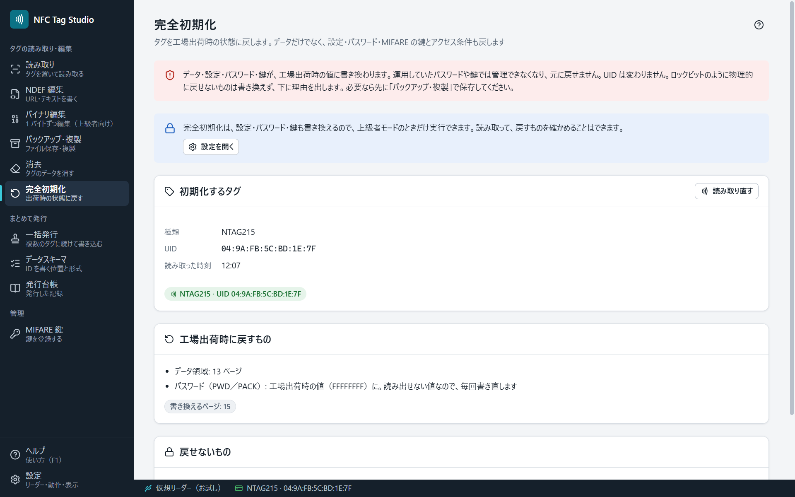

# 完全初期化

「完全初期化」では、タグを**工場出荷時の状態**に戻します。データだけでなく、設定（パスワード保護・NFC カウンタ・ミラー）・パスワード・MIFARE の鍵とアクセス条件・FeliCa の MC も、工場出荷時の値に書き換えます。**UID（製造番号）は変わりません。**

データだけを消すときは [[消去]] を使います。

## 実行するまで

1. 「設定」で上級者モードをオンにします（設定・パスワード・鍵も書き換えるため。オフでも、読み取って確かめることはできます）。
2. 初期化するタグをリーダーの上に置き、［タグを読み取る］を押します。**この画面では、タグを置いただけでは読み取りません。**
3. 「工場出荷時に戻すもの」と「戻せないもの」を確かめます。
4. 画面の下の［初期化する］を押します。確認に、初期化するタグ（種類と UID）が出ます。「初期化」と入力してから実行します。

## 工場出荷時に戻すもの

| タグ | 戻すもの |
|---|---|
| NTAG213/215/216 | ユーザー領域（NTAG213 はロックの情報（Lock Control TLV）と空の NDEF、215/216 は空の NDEF）、容量情報（CC。一度だけ書ける領域なので、戻せる形のときだけ）、設定（CFG0／CFG1: パスワード保護・NFC カウンタ・ミラーを止める）、パスワード（PWD を FFFFFFFF、PACK を 0000） |
| MIFARE Classic | 読み取れたセクタのデータブロックを 00、トレーラを工場出荷時の鍵（FFFFFFFFFFFF）とアクセス条件（FF 07 80 69） |
| FeliCa Lite-S | S_PAD0〜S_PAD13 と REG を 00、MC を工場出荷時の値（保護の設定はそのまま） |

パスワード（NTAG）と鍵 A（MIFARE）は読み出せない値なので、すでに工場出荷時の値でも、毎回書き直します。

## 戻せないもの（書き換えずに、理由を出します）

- ロックビット（一度立てると戻せません）と、ロックされたページ・ブロック
- 設定の恒久ロック（CFGLCK）がかかった NTAG の設定のページ
- 工場出荷時の値に戻せない形に変わった容量情報（CC）
- NFC カウンタの値（カウンタは止めますが、数えた値は戻せません）
- 鍵かパスワードが必要で読めなかった所（MIFARE Classic は、[[MIFARE鍵]] で鍵を登録してから読み取り直してください）
- FeliCa の書込保護（一度有効になると戻せません）と読取保護、システムブロックが読み取り専用になった MC

## 初期化できないタグ

- **パスワードで保護された NTAG**: 保護を外さないと、設定のページを書き換えられません。ACR122U などのリーダーで、[[バイナリ編集]]からパスワードを入力して保護を外してから、もう一度試してください。Sony PaSoRi などのストレージ方式のリーダーでは、パスワード認証ができません。
- **読み取りが途中で途切れたタグ**: 置き直して、読み取り直してください。

## 安全のための動き

- 実行の直前にタグをもう一度読み取り、読み取ったタグと別のタグや、中身が変わったタグには書き込みません。
- 書き込んだあとは読み戻して照合します（パスワードは読み出せないので、照合から外します）。結果は画面の下に残ります。
- 設定を変えたときは、タグを置き直すと有効になります。
- 運用していたパスワードや鍵では管理できなくなり、元に戻せません。大切なタグは、先に [[バックアップと複製]] で保存してください。

終わったら、画面の下の［閉じる］で、読み取る前の画面に戻ります。

## 確かめた範囲

- Sony PaSoRi と NTAG213 の実物で確かめました（2026-11-14）。
- NTAG215／216・MIFARE Classic・FeliCa Lite-S は、仮想リーダーで確かめました。
