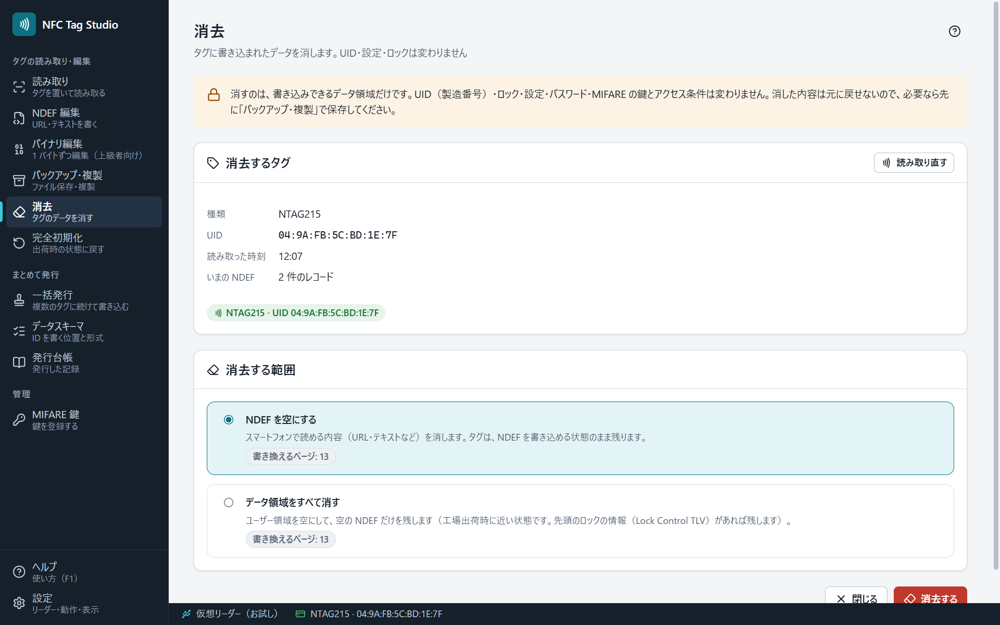

# 消去

「消去」では、タグに書き込まれた NDEF やデータを消します。**UID（製造番号）・ロック・設定・パスワード・MIFARE の鍵とアクセス条件は変わりません。**

## 消去するまで

1. 消去するタグをリーダーの上に置きます。
2. ［タグを読み取る］を押します。**この画面では、タグを置いただけでは読み取りません**（消去は、読み取ってから始めます）。
3. 「消去するタグ」で、種類・UID・いまの NDEF を確かめます。
4. 「消去する範囲」を選びます。
5. 画面の下の［消去する］を押します。確認に、消去するタグ（種類と UID）が出ます。

| 範囲 | 消えるもの |
|---|---|
| NDEF を空にする | スマートフォンで読める内容（URL・テキストなど）。タグは NDEF を書き込める状態のまま残ります（NTAG・NDEF の形式の MIFARE Classic） |
| データ領域をすべて消す | NTAG: ユーザー領域を空にして、空の NDEF だけを残します（工場出荷時に近い状態。NTAG213 が工場出荷時に持っている先頭のロックの情報（Lock Control TLV）が残っていれば、残します）。 MIFARE Classic: 読み取れたセクタのデータブロックを 00 にします（トレーラと block 0 は変わりません。NDEF の形式（MAD）も消えます）。 FeliCa Lite-S: S_PAD0〜S_PAD13 を 00 にします（REG と MC は変わりません） |

範囲ごとに、書き換えるページ・ブロックの数が出ます。もう消去された状態なら「すでに消去された状態です」と出て、［消去する］は押せません。

## 安全のための動き

- 消去の直前に、タグをもう一度読み取ります。**読み取ったタグと別のタグや、読み取ったあとで中身が変わったタグには書き込みません**（いまの中身を表示し直すので、確かめてから消去してください）。
- 書き込んだあとは読み戻して照合します。結果は画面の下に残ります。
- ロックされたページや、鍵かパスワードが無くて読めなかった所は、消去できません（理由を表示します）。MIFARE Classic は、[[MIFARE鍵]] で鍵を登録してから読み取り直してください。
- 消去した内容は元に戻せません。大切なタグは、先に [[バックアップと複製]] で保存してください。

## 終わったら

画面の下の［閉じる］で、読み取る前の画面に戻ります（タグは変わりません）。別のタグを消去するときは、タグを置き替えて［読み取り直す］を押すか、［閉じる］から始め直します。

NDEF 編集の画面にも［NDEF を消去］があります（[[NDEF編集]]）。
