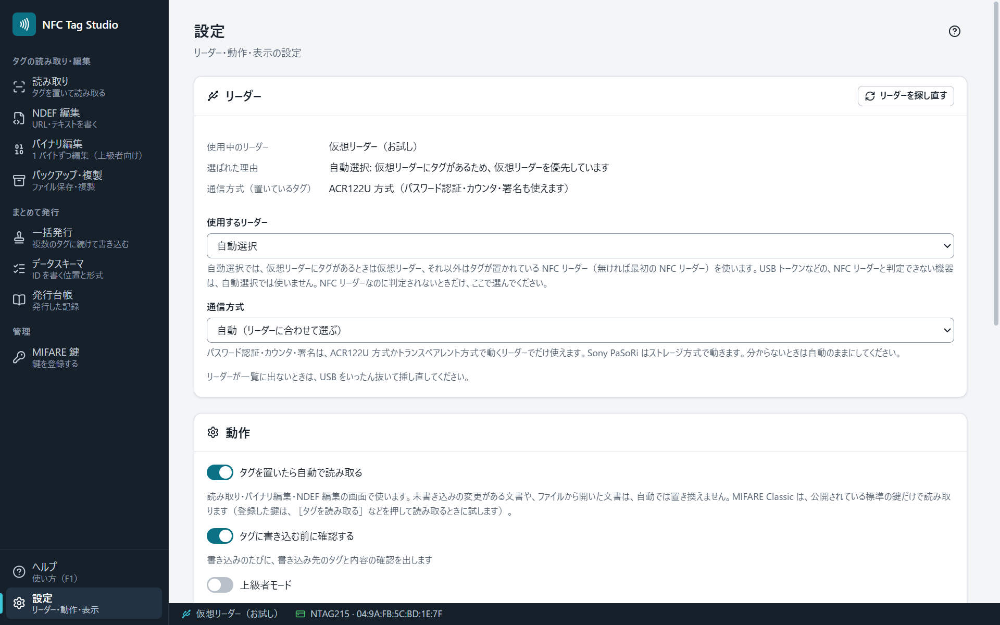

# 設定

## リーダー

| 項目 | 説明 |
|---|---|
| 使用中のリーダー・選ばれた理由 | いま使っているリーダーと、それを選んだ理由 |
| 使用するリーダー | 「自動選択」か、特定のリーダー |
| 通信方式 | ふだんは「自動（リーダーに合わせて選ぶ）」（[[対応リーダーとタグ]]） |
| 通信方式（置いているタグ） | いま使っている方式 |
| ［リーダーを探し直す］ | リーダーの一覧を作り直します |

「自動選択」のときは、[[仮想リーダー]]にタグがあれば仮想リーダー、それ以外はタグが置かれている NFC リーダー（無ければ最初の NFC リーダー）を使います。特定のリーダーを選んだときは、そのリーダーだけを使います。選んだリーダーが接続されていないと「選んだリーダーが接続されていません」と出るので、つなぎ直すか［自動選択に戻す］を押します。

USB セキュリティトークンなど、NFC リーダーと判定できない機器は自動選択では使いません。選ぶときは確認が出ます（選ぶと、その機器にタグを確かめるコマンドを送ります）。

## 動作

| 項目 | 説明 |
|---|---|
| タグを置いたら自動で読み取る | 「読み取り」「バイナリ編集」「NDEF 編集」の画面で使います。未書き込みの変更がある文書や、ファイルから開いた文書は置き換えません |
| タグに書き込む前に確認する | 書き込みのたびに、書き込み先のタグと内容の確認を出します |
| 上級者モード | 保護領域の編集・ロック・パスワードの設定など、取り消せない操作を使えるようにします |

## 表示

テーマ（システムに合わせる・ライト・ダーク）・言語（日本語・English）・効果音（読み取り・書き込み・一括発行の成否を音で知らせる）を選べます。

## このアプリについて

版とライセンスが出ます。［初回ガイドをもう一度見る］［ヘルプを開く］もここにあります。ヘルプは F1 でも開けます。
