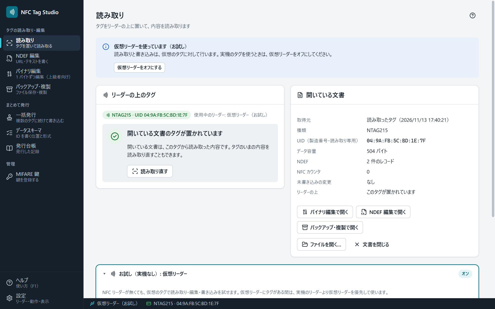

# 読み取り

「読み取り」画面は、「リーダーの上のタグ」と「開いている文書」の 2 つの欄に分かれています。

## リーダーの上のタグ

いまリーダーに置かれているタグの状態です。どの画面でも、同じ表示が出ます。

| 表示 | 意味と、すること |
|---|---|
| タグを置いてください | タグがありません。リーダーの中央に置きます |
| 確認中… | タグの種類を確かめています。そのまま置いておきます |
| うまく読み取れません。タグをリーダーの中央に置き、動かさないでください | 読める範囲の端にあるなど、応答が不安定です。置き直します |
| タグを検出しました | 読み書きできます |
| 対応していない種類のタグです | このアプリが扱えないタグです（[[対応リーダーとタグ]]） |
| 読み取れません | 応答がありません。置き直すか、［もう一度確認］を押します |

## 開いている文書

読み取ったタグや、ファイルから開いた内容です。タグを離しても残ります。

- 新しいタグを置くと、自動で読み取ります。ただし、**未書き込みの変更がある文書や、ファイルから開いた文書は、自動では置き換えません**。「開いている文書とは別のタグです」と出るので、［このタグを読み取る］を押します。
- 読めなかった領域は、理由ごとに分けて示します。
  - 「鍵かパスワードが必要で読めなかった」: MIFARE の鍵や NTAG のパスワードが要る領域です。
  - 「読み取れなかった」: 通信が途切れた領域です。タグを置き直して読み取り直します。
- ［バイナリ編集で開く］［NDEF 編集で開く］［バックアップ・複製で開く］で、その画面に移ります。
- 保存したファイル（.nfcdump・.bin・Flipper の .nfc）は、［ファイルを開く…］で開けます。

## 自動読み取り

タグを置くと自動で読み取ります（「読み取り」「バイナリ編集」「NDEF 編集」の画面）。[[設定]]の「タグを置いたら自動で読み取る」でオフにできます。オフのときは［タグを読み取る］を押します。

MIFARE Classic は、自動読み取りでは公開されている標準の鍵だけを試します。登録した鍵で開くセクタは、［タグを読み取る］を押すか、「鍵かパスワードが必要で読めなかった」の欄の［登録した鍵で読み取る］で読みます（[[MIFARE鍵]]）。

## 読み取り中にタグを離したとき

読み取りは失敗として扱い、「処理の途中でタグが離れました」と出ます。途中までの内容を、読み取れたものとして開くことはありません。タグを置き直して、読み取り直してください。
